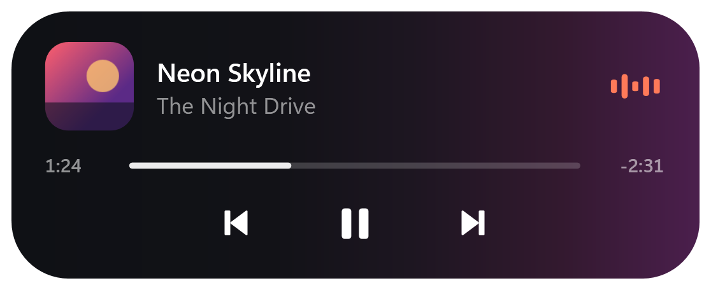
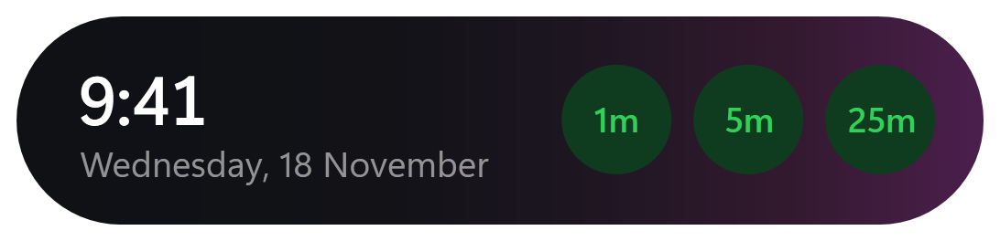
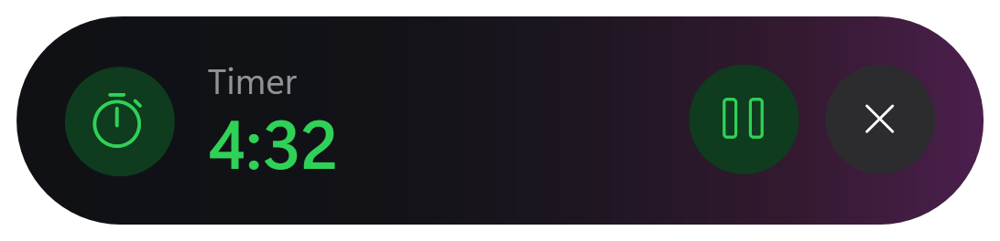

<div align="center">



# Dynamic Island for Windows

**A living, morphing pill at the top of your screen — inspired by the iPhone's Dynamic Island, built natively for Windows 11.**

It stays out of your way as a thin sliver, then springs open for music, notifications, timers, and system events.

[](https://github.com/AyushDas4890/Dynamic_Island_for_Windows/releases/latest)


</div>

---

## Features

### 🎵 Now Playing
Works with **any** app that shows up in Windows' media controls: Spotify, YouTube in any browser, Windows Media Player and more.


- Album art, title and artist
- Waveform tinted with the **album's own colour**
- Live progress bar with elapsed / remaining time
- Previous · Play/Pause · Next

### 🔔 Notifications
Windows notifications appear inside the island with the app's icon, sender and message.


### ⏱️ Timer
Hover the empty island for a clock and one-tap **1 / 5 / 25 min** timers (great for Pomodoro). Pause, resume or cancel; it chimes when done.

<br/>


If music and a timer run together, the timer **splits off into its own bubble** with a progress ring — just like the iPhone.

### 📋 Clipboard · 🎧 Bluetooth · 🔋 Charging
Quick pills for everyday moments.

<br/>
<br/>


- **Copied** with a preview of what you copied (secrets from password managers are never shown)
- **Connected / Disconnected** for headphones, mice, keyboards
- **Charging** with battery level when you plug in

### 🟢🟠 Privacy indicators
The resting sliver shows a **green dot when your camera is on** and an **orange dot when your microphone is in use** — so nothing records without you noticing.

| Music playing | Camera on | Microphone on |
|:---:|:---:|:---:|
|  |  |  |

---

## Designed to feel alive

The motion follows Apple's own fluid-interface principles (WWDC *Designing Fluid Interfaces*, *Design dynamic Live Activities*):

- **Spring physics, not fixed-time animations** — every change can be interrupted mid-flight and re-targeted from its current position and velocity.
- **Instant response** — the sliver nudges the moment your cursor arrives; buttons shrink on press and act on release.
- **Content arrives with the shape** — views fade and scale in just after the island begins to grow.
- **Concentric geometry** — corner radii nest evenly around the art and buttons inside.
- **Stays out of the way** — rests as a tiny sliver, never steals focus, never appears in Alt-Tab, and does **no per-frame work when idle** (near-zero CPU).
- Respects Windows' *"Animation effects"* setting (reduced motion).

---

## Install

1. Download **`DynamicIsland.exe`** from the [latest release](https://github.com/AyushDas4890/Dynamic_Island_for_Windows/releases/latest).
2. Double-click it. That's it — no installer, no .NET needed (it's bundled).

> Windows SmartScreen may warn because the app isn't code-signed. Click **More info → Run anyway**.

### Turning it on and off

Everything lives in the **tray icon** (bottom-right; it may be under the `^` arrow — drag it onto the taskbar to keep it visible).

| Action | How |
|---|---|
| Hide / show the island | Left-click the tray icon, or **Hide island** |
| Launch at sign-in | **Start with Windows** (off by default) |
| Quit completely | **Quit Dynamic Island** (also on the island's right-click menu) |

### Using it

| Gesture | Result |
|---|---|
| Move the mouse to the top-centre | Island nudges, then opens |
| Click the island | Open / close instantly |
| Move away | Collapses back to the sliver |
| Click an alert | Dismiss it |

### Notifications access
Reading notifications needs Windows' notification access. If the island's right-click menu says notifications are off, enable **Settings → Privacy & security → Notifications → Let apps access your notifications**.

---

## Build from source

Requires the [.NET 8 SDK](https://dotnet.microsoft.com/download/dotnet/8.0) on Windows 10 2004+ / Windows 11.

```bash
git clone https://github.com/AyushDas4890/Dynamic_Island_for_Windows.git
cd Dynamic_Island_for_Windows
dotnet run
```

Create the standalone single-file exe:

```bash
dotnet publish -c Release -r win-x64 --self-contained true -p:PublishSingleFile=true -p:IncludeNativeLibrariesForSelfExtract=true -p:EnableCompressionInSingleFile=true -p:DebugType=none -o dist
```

Regenerate the README images (rendered with demo content):

```bash
dist\DynamicIsland.exe --screenshots docs\screenshots
```

## How it works

| Feature | Windows API |
|---|---|
| Overlay window | WPF layered window, `WS_EX_TOOLWINDOW` + `WS_EX_NOACTIVATE` (no focus stealing, not in Alt-Tab) |
| Now playing | `GlobalSystemMediaTransportControlsSessionManager` (WinRT) |
| Notifications | `UserNotificationListener`, polled (its change event is unsupported for unpackaged apps) |
| Camera in use | Media Foundation `MFCreateSensorActivityMonitor` |
| Microphone in use | Core Audio session state on capture endpoints |
| Bluetooth | `DeviceWatcher` for connected Bluetooth / BLE devices |
| Clipboard | `AddClipboardFormatListener` |
| Charging | `SystemEvents.PowerModeChanged` + `GetSystemPowerStatus` |

Native COM bindings are generated by [CsWin32](https://github.com/microsoft/CsWin32) from Microsoft's official metadata. Design notes and research live in [`docs/RESEARCH-AND-DESIGN.md`](docs/RESEARCH-AND-DESIGN.md).

## Privacy

Everything runs **locally**. Dynamic Island makes no network requests and stores nothing; notifications, clipboard text and media info are only displayed on your screen.

## License

[MIT](LICENSE) © Ayush Das

<sub>Not affiliated with Apple. "Dynamic Island" is used descriptively for the design concept.</sub>
